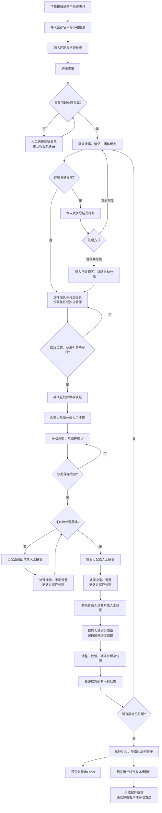

# 志愿者自动分组项目说明书

版本：1.0｜日期：2026-11-04｜状态：功能测试版已实现

## 1. 产品目标与交付

开发中文、可离线运行的 HTML 网页，统一管理多来源志愿者名单，完成查重、任职选择、按关系分组、人工调整、阶段确认、版本回退及 Excel 导出。

交付网页入口及本地配套资源，解析和导出所需依赖随项目提供，不依赖外部 CDN。名单在本机处理，不要求账户或服务器。邮件功能生成带附件的草稿，由用户通过兼容邮箱客户端手动发送，不在网页中保存邮箱密码或直接发信。

## 2. 导入模板与字段

支持下载 Excel 模板，兼容已有 Excel（.xlsx）和 CSV，通过工作表选择、表头识别和列名匹配导入。CSV 每个文件视为一张表。保留来源文件、工作表、原始行及原始字段，学号按文本处理。

| 模板 | 必填内容 | 规则 |
|---|---|---|
| 小组信息 | 组号、小组名称、总名额 | 可填写区域，名额包含组长 |
| 内部人员 | 姓名、学号、报名意向 | 意向为小组长、区长、两者均报名、不报名 |
| 团体人员 | 姓名、学号 | 单团体表可在导入时指定名称；多团体表需团体名称列 |
| 情侣人员 | 姓名、学号、关联志愿者姓名（或配对编号） | 优先填写伴侣姓名，配对编号可留空；每人一行 |
| 家属人员 | 姓名、关联志愿者姓名 | 学号如有则填写，按关联志愿者的名字匹配 |
| 普通人员 | 姓名、学号 | 用于最后补齐名额 |

所有人员模板可含邮箱、摄影标志、小闪电标志和其他业务字段。两个特殊标志独立填写“是/否”，允许同时具有。已有表缺少学号时进入人工核对流程，不凭姓名自动合并。

不需要上传储备表。提供的《总表6.2(1).xlsx》用作格式和小组信息参考，不把其中真实人员预置进应用；历史储备页不自动纳入本次分配。导入小组信息应识别合并单元格；组号允许重复，每个项目保留独立卡片、名额和名单，以“组号 + 项目名称”区分。相同组号不自动汇总名额；导入前展示预览，避免计入合计行。

## 3. 第一关：跨表查重

所有名单导入后，首先查重，不能跳过确认直接分配。

1. 相同学号归入重复候选；同名不同学号、无学号同名只提示人工核对。
2. 并排展示重复记录、来源表单和不同字段。
3. 用户决定保留在哪个表单，其他记录从本次分配池排除；保留审计记录，不修改上传文件。
4. 保留来源决定其分配阶段。标签与关系单独确认，不能随重复记录静默丢失。
5. 所有问题处理后确认最终名单。后续追加或替换文件时重新查重，并标记受影响安排待检查。

系统为每个人分配稳定内部编号，不能仅用姓名作为内部唯一标识。普通人员保留到内部来源后不再参与普通补位，但若用户保留其团体关系，仍需满足该关系。

## 4. 关系、身份与容量

### 4.1 同组关系

- 团体默认整体同组，情侣默认成对同组，家属随关联志愿者同组。
- 家属和情侣均支持“关联志愿者姓名”匹配；唯一匹配自动提出关联，重名或未找到时标红，可人工选择或暂存后继续。情侣允许一方填写、双方互填，也兼容配对编号；姓名和编号产生多伴侣冲突时要求人工修正。
- 交叉关系形成一个完整绑定单元，相关人员统一计入容量。例如内部人员、其伴侣及家属可跨表形成同一单元。
- 绑定默认不可拆，可由用户明确修改；不因算法放不下而自动拆分。
- 跨阶段绑定在首次需要安置时整体确定位置，关联成员标记为已安排，不在后续重复分配。内部人数统计只计实际内部人员，家属等只占总名额。
- 同一单元存在不同固定组、缺失成员或容量冲突时，明确提示并处理。

### 4.2 摄影与小闪电

摄影、小闪电是可附着于任何来源人员的标签，不是独立名单或分配阶段。分别统计各组数量，包含已安排的同类人员；同时拥有两个标签者两类均计数，但只占一个名额。

均衡标签属于尽量满足的偏好，不覆盖容量、绑定和已确认安排。各阶段优先使用当前可分配人员改善均衡；不宣称分阶段固定后的结果必然达到全局最优。

## 5. 区长与小组长

- 从内部名单选择任职人员，报名意向与实际任职分开保存。
- 组长候选默认展示报名者，可展开全部内部人员；已任职状态清晰可见。第一版同一人最多担任一个小组的小组长。
- 组长固定到对应组，从待分配池剔除，避免再次分配或进入储备；占一个名额，导出时单独标识且不重复列为普通组员。
- 区长可选，不设置时显示“区长：未设置”，不影响后续流程。
- 可维护区域并关联多个小组，组卡显示该区域区长；未关联区域的小组也可指定区长。同一区长可以负责多个组。
- 区长可兼任组长或组员，在小组中仅计一次。独立区长不占小组名额，也不参与内部均分。
- 区长若有同组绑定，必须明确其编组方式并解决冲突后继续。

## 6. 自动分配与人工接管

### 6.1 分配顺序

**内部人员 → 逐个团体 → 情侣 → 剩余普通人员。**

没有对应人员的阶段显示“无待分配人员”，允许确认跳过并保存阶段状态。家属跟随关联人员，不设最后独立安排家属的步骤。

### 6.2 分配规则

先满足硬约束：唯一分配、不超容量、锁定位置和不可拆关系。随后满足当前阶段人数均衡，再改善摄影、小闪电分布；同等条件随机，并记录随机种子以便恢复。

| 阶段 | 自动行为 | 人工确认 |
|---|---|---|
| 内部人员 | 尽量均分剩余内部人员，不把组长计入内部均分人数；容量和绑定允许时数量差尽量不超过1 | 可调整后确认固定 |
| 团体 | 选择当前团体，以完整绑定单元放入可容纳的组，结合容量使用率与标签分布选择 | 每个团体单独修改、确认、保存 |
| 情侣 | 尚未安排的情侣及关联成员整体同组 | 本阶段统一修改、确认、保存 |
| 普通人员 | 按剩余容量补齐，兼顾标签，同等条件随机 | 正式和储备可交换，确认后保存 |

搜索方案时允许调整本阶段尚未锁定的建议，不能自动改变此前确认安排。不能找到安置方案时应区分“搜索未找到方案”和确定的容量冲突，不误报数学上无解。

总名额不足时，剩余普通人员进入储备。其附带的不可拆关系整体保留，不把家属单独留下。团体或情侣放不下时作为待处理冲突，不自动混入普通储备；须调整容量、位置或关系后再确认阶段。

### 6.3 人工接管

每个阶段可直接人工分配，无需先运行自动分配；也可以自动后调整或只安排部分人员。

统一操作入口：**自动分配、人工接管、分配剩余人员、撤销、重做**。

手动安排的单元默认锁定，分配剩余人员只处理未锁定单元。允许明确解锁后重新分配。人工接管不绕过容量与关系校验；需要改变约束时先明确修改规则。

## 7. 完整流程图

图中所有“确认并保存”均遵循保存成功后才可继续。任意阶段可以打开历史版本回退；已确认小组可提前导出，不必等待全部阶段完成。

## 8. UI 与完善的人机交互

### 8.1 工作台布局

左侧：导入、查重、任职、内部、团体、情侣、普通、总览、导出邮件等流程导航。

中间：当前阶段、人数摘要、搜索筛选、待分配区和小组卡片。右侧：人员详情、来源、标签、关系及操作。底部：上一步、保存状态、确认本阶段。

浅灰背景、白色卡片、蓝色主操作；绿色表示已确认，橙色表示待处理，状态同时提供文字。

### 8.2 小组信息始终可见

每个组的卡片、表格视图和拖拽目标都显示**组号、小组名称、组长名字、区长名字**。区长未设置时明确显示“未设置”。组内名单滚动时固定组头。

同时显示已分配/总容量、剩余名额、内部人员数量、摄影和小闪电人数。支持卡片/表格视图切换及按组查找。

### 8.3 姓名颜色与图标

| 信息 | 展示 |
|---|---|
| 内部来源 | 浅蓝姓名底色 |
| 团体来源 | 浅紫姓名底色 |
| 情侣来源 | 浅粉姓名底色 |
| 家属来源 | 浅橙姓名底色 |
| 普通来源 | 浅灰姓名底色 |
| 摄影 | 姓名旁 📷 |
| 小闪电 | 姓名旁 🏃 |
| 情侣或家属关系 | 姓名旁 🧑‍🤝‍🧑 |
| 不同团体 | 不同颜色的小旗图标，同团体同色 |

姓名底色以查重后保留的来源类别为准；关系和标签可跨来源保留，图标可叠加。小旗采用可着色图标，不依赖红旗 emoji 改色。提供图例与文字提示，不能仅靠颜色辨认。

悬停或点击 🧑‍🤝‍🧑 展示关系类型和成员，点击可高亮整个绑定单元。旗帜提示团体名称；摄影与小闪电图标有文字说明。组长、区长角色单独标识。选中状态使用勾选和外框，不覆盖来源底色。

### 8.4 拖拽与批量操作

- 支持人员在小组、待分配区、储备区间拖拽；按阶段与锁定规则控制可操作范围。
- 勾选多个人，支持 Shift 连选、全选当前筛选结果、取消选择，持续显示选中数量。
- 多选后可整体拖拽、批量移动或交换；提供“移动到…”按钮和键盘操作，避免只能拖拽。
- 选中绑定成员时提示关联成员，实际移动携带完整单元；预览真实人数，重叠绑定只计一次。
- 拖拽悬停显示目标容量变化；不可放入时显示原因，松手不执行。
- 批量操作整体校验、整体提交，失败时列明原因，不静默部分成功。
- 支持跨组单人/多人交换，提交前同时检查双方容量和关系。
- 搜索姓名、学号；按来源、团体、角色、标签和状态筛选。大名单支持滚动跟随，清楚区分当前可见人数与总人数。
- 修改即时更新人数和标签统计。普通移动可撤销；拆分绑定、修改已确认安排等需明确确认。

## 9. 阶段快照、撤销与恢复

确认阶段时先保存完整快照，成功后才推进流程；每个团体确认均单独保存。保存失败不显示“已保存”，不自动进入下一阶段，并提供重试和项目备份入口。

快照包括原始来源、查重决定、人员字段与稳定编号、标签、关系、小组名额、任职、分配、储备、锁定、随机种子及确认进度。

历史版本显示阶段名称、保存时间和人数变化，支持恢复任一快照。恢复前先保存当前状态；保留旧历史作为分支，不删除后续版本。单步撤销/重做与整阶段回退分别提供。

采用浏览器本地持久化存储保存快照，支持下载/导入带版本号的项目备份；恢复校验文件结构和编号一致性。界面明确显示保存时间和状态。浏览器存储清理或更换浏览器不会自动带走数据，下载备份用于跨环境恢复。

返回修改前序阶段时标记受影响的后续阶段待复核，不自动覆盖用户安排。退出有未保存更改时提示。浏览器对直接打开本地文件的存储支持需实际验证；不支持时提供稳定本地启动入口或显式文件备份流程，不虚报自动保存成功。

## 10. Excel 与邮件草稿

用户选择一个或多个组，勾选并排序输出列，预览后导出。支持一个 Excel 每组一张表，或每组独立 Excel 打包下载。可导出储备和小组统计；人员字段保留原始值，学号为文本。导出内容按文本安全写入，不能把人员输入当作公式执行。

组长单独标识，不与普通组员重复；小组信息包括组号、名称、组长及可选区长。图标信息在可选身份字段中输出为明确文字，不能只用颜色或 emoji 表达。

每位组长一封邮件，仅附本组名单，附件使用本次选定列。编辑主题、正文，预览收件人及附件，邮箱缺失或格式错误时提示。建议输出含 MIME 附件的 .eml 草稿，批量时打包，设置草稿标志；须验证所用客户端能打开为可编辑草稿并保留附件。客户端不兼容时提供 Excel 与主题/正文复制入口，明确不能保证所有客户端行为一致。

不直接发送邮件，不记录“发送成功”；仅显示草稿生成状态。名单、列设置或版本变化后标记此前导出已过期，要求重新生成，草稿和附件记录对应快照版本。

## 11. 核心内部数据与兼容

最小实体包括人员、来源记录、关系边、团体、区域、小组、任职、分配状态、阶段及快照。人员身份与来源分离；关系指向稳定人员编号，家属姓名仅用于导入匹配。

所有人员必须属于明确状态：已编组、待分配、关联待处理、储备或独立管理。恢复文件包含格式版本，未知版本不得静默加载；失败不覆盖当前项目。

第一版以桌面浏览器为主要操作环境，较窄窗口仍能查看信息和使用按钮操作。大量名单采用分页或虚拟列表，不让拖拽和筛选阻塞界面。真实名单只由用户导入，示例和演示使用虚构数据。

## 12. 验收场景

1. 多文件、多工作表、不同表头、合并单元格可以预览后正确导入；学号前导零保留。
2. 重复人员可人工选择保留来源；同名不同学号不自动合并；身份标签与关系不丢失。
3. 家属按姓名唯一匹配，重名/未找到均需解决；交叉绑定完整计算容量。
4. 组长从待分配池剔除且占一名额；区长可不设、独立或兼任，均不重复计数。
5. 内部人员均分不含组长；每团体分别确认；情侣不拆；普通超额进入储备。
6. 摄影、小闪电跨类别统计，双标签占一名额；无法均衡时不破坏硬约束。
7. 任一阶段可直接人工接管；部分锁定后自动只分剩余人员。
8. 单人和批量拖拽、交换、键盘移动、筛选多选、撤销重做符合容量和关系规则；失败不部分修改。
9. 每组四项核心信息始终可见；姓名底色、关系图标、彩旗和标签提示一致。
10. 每阶段及每个团体保存快照；模拟保存失败不得推进；回退前备份并能恢复刚才状态。
11. Excel 列选择和排序准确，多表/多文件导出正确；组长与成员不重复；每位组长邮件只附本组名单。
12. 断网完成导入、分配、保存恢复和导出；通过目标客户端验证中文邮件草稿及附件。

最终人员核对：去重后总人数 = 已编组人数 + 储备人数 + 待分配人数 + 独立管理人数，各集合互不重叠。全部完成时待处理冲突及待分配人数应为零，或由用户明确保留为未完成状态，不能误报完成。

### 情侣匹配后的类别更新

普通人员一旦成功匹配为某人的伴侣，会自动归入情侣类别，姓名按情侣颜色显示，和伴侣一起分配，不再单独参与普通人员补位。原文件、原始字段和来源记录保留。内部、团体及家属类别不因匹配被覆盖，但仍遵守同组关系。重名待确认、未找到人员或多伴侣冲突时不自动升级。解除全部情侣关系后，仅自动升级过的人员恢复普通类别；原本的情侣类别不自动改变。

## 最新交互约定（2026-11-04）

1. 导入列名按精确匹配优先、包含关系其次自动推荐；选择状态绿／黄显示，完整预览支持双向滚动。情侣支持关联志愿者姓名或情侣姓名，摄影和小闪电分别读取是／否。
2. 查重预选优先级为团体高于普通、情侣高于普通，必须人工确认后才保留；团体与情侣之间仍由人工决定。
3. 关联异常扩展标记到全部绑定成员及重名候选。允许暂存并继续，单列待处理，不进入储备、不自动分配。修复后重新检查及确认；最终确认仍要求异常清零。
4. 人员详情在储备卡片上方，含标签、任职意向、姓名关联、绑定成员和所有来源原始字段。
5. 当前阶段待分配人员优先展开，其他类别折叠。自动分配可选即时、正常、慢速动画；以绑定组合为单位移动姓名标签，支持暂停、立即完成、取消还原及整次撤销。
6. 组号可重复，不同项目通过独立编号保存位置和来源，按“组号 + 项目名称”展示与导出。各项目有独立容量；同组号项目共用组长，区长可分别设置。

## 已导入表格重新编辑

每张已导入工作表提供“修改导入”。编辑以独立草稿进行，支持类别、表头、字段映射、默认团体名和数据单元格修改。先预览影响，再原子替换原来源，保存前后历史；失败或取消不改变当前数据。替换后重新查重、检查任职及分配，不静默沿用此表旧的手动修改或安排。其他来源保留。新导入表格存储完整导入配置和行数据；旧记录从原始字段重建并明确显示格式无法恢复的限制。

同组号的多个项目共用同一位组长，选择或清空其中一个项目的组长时会同步同组其他项目。不同组号仍不能共用组长。组长及其绑定成员只编入同组内一个容量足够的项目，人数只计一次；所有项目卡片及导出表头均显示共用组长。

任职页支持“自动分配组长”。默认从报名小组长或“两者均报名”的内部人员中选人，同组号项目共用一位组长，已有选择保留并同步。考虑绑定关系及项目容量，排除关联异常、暂存人员和独立区长。候选不足时显示未安排组号；勾选“全部内部人员”后可补选未报名人员，仍优先报名人选。自动建议后可手动调整或撤销，点击“确认并继续”才保存阶段并固定组长位置。有已有分配进度时会先保存修改前快照。

任职页每行“编辑”旁提供“删除”。只删除该项目，同组号其他项目保留；组内人员及绑定成员回到待分配，不删除人员名单。失去全部任职的独立区长也回到待分配。删除前后保存历史，支持撤销，任职和后续分配须重新确认。

摄影／小闪电已映射列的值包含“报名”（如“已报名”“报名摄影志愿者”）时识别为是；包含“不”“未”“否”“取消”“放弃”等否定或待定表述时优先识别为否。仍兼容原有“是／否”值。仅字段标题包含“报名”不会把整列所有人员标记为是。

## 2026-11-05 交互与分配更新
- 相同组号共用组长，每行作为独立子岗位；卡片显示子岗位序号，人数按岗位统计。
- 每阶段按来源表导入先后、表内从上到下分配；绑定组合以最早行排队，组合内按行排序。已确定的分配和人工拖拽顺序保留。
- 修复删除小组后“确认并继续”保持禁用的问题。
- 姓名或学号搜索后按 Enter，自动切换到对应分页并滚动定位，优先完全匹配；多人匹配时提示人数。
- 编辑人员可选择“放弃参加”并填写可选原因。顶部可打开退出名单并恢复参加，恢复后进入待分配。退出记录随项目保存，修改原导入表不会自动恢复退出人员。
- 导入小组预览支持添加和删除子岗位，确认前均为草稿，不修改原 Excel。
- 拖拽时，绿色虚线表示可移入，灰色表示不可移入，并显示原因；依据容量、绑定、锁定、任职等现有规则。当前没有岗位报名资格字段，未启用“未报名项目”限制。
- 绑定人员显示同色竖条，悬停同步高亮全部绑定同伴。
- 顶部缩为已分配/名单、待分配/名单两个圆盘；储备人数以文字显示，侧边储备名单保留。

验证：新增逻辑测试与全部既有回归测试通过。本次未执行浏览器视觉验收。

### 自定义 Excel 列名称
导出页每个列标签右侧新增 ✎ 改名按钮。输入名称并保存后，预览、Excel（含储备表及邮件附件）同步使用新表头；原始字段与数据不变。支持恢复默认名称，设置随项目保存，拖拽排序和取消再选择不会丢失改名。

顶部第二个圆盘现为“已分配 / 总需求”：总需求为所有子岗位名额合计，圆环进度使用同一比例。第一个圆盘仍为“已分配 / 名单”。

### 自定义字段标签
“新增标签”用于添加和姓名、学号并列的自定义字段，如学院、手机号、尺码。每个标签可选择原表已有列，支持自动识别、手动匹配和删除标签。不会新增或修改原表列。映射随导入草稿保存，导入后显示在人员详情，并能在导出字段中选择。
